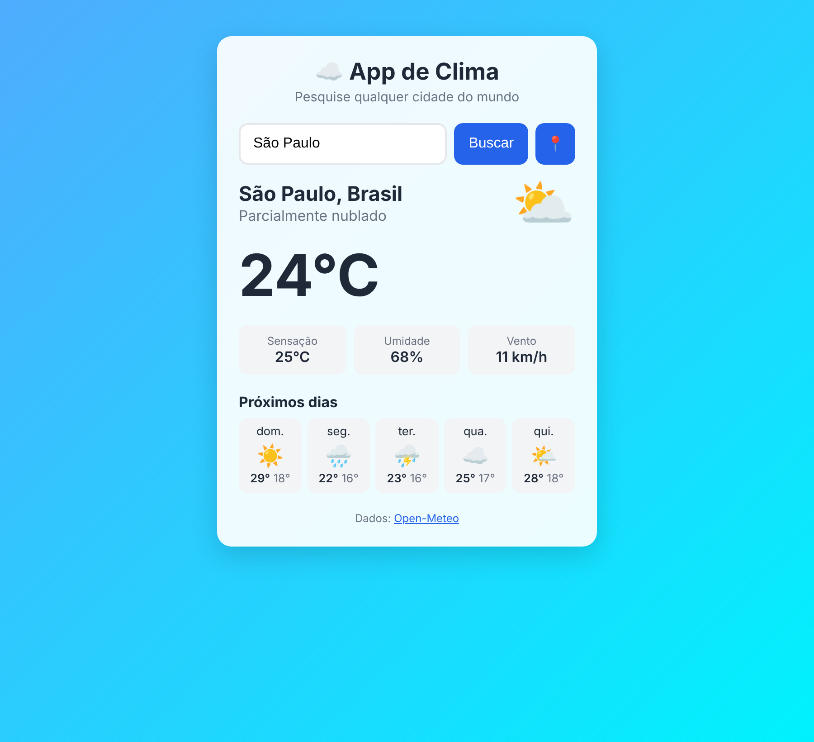
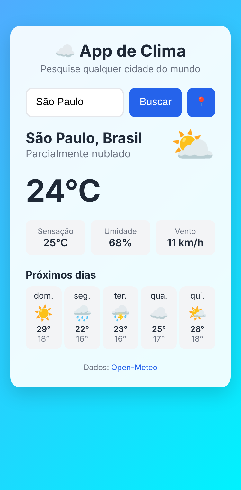
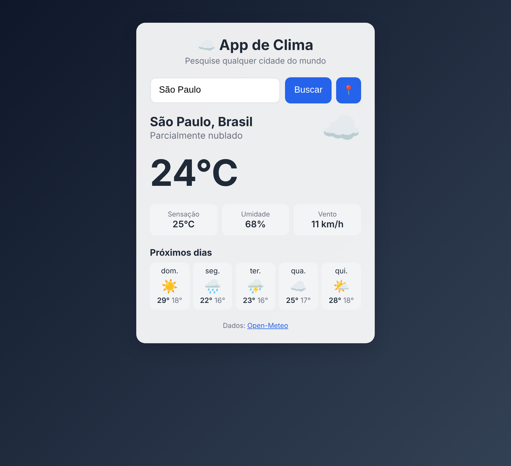
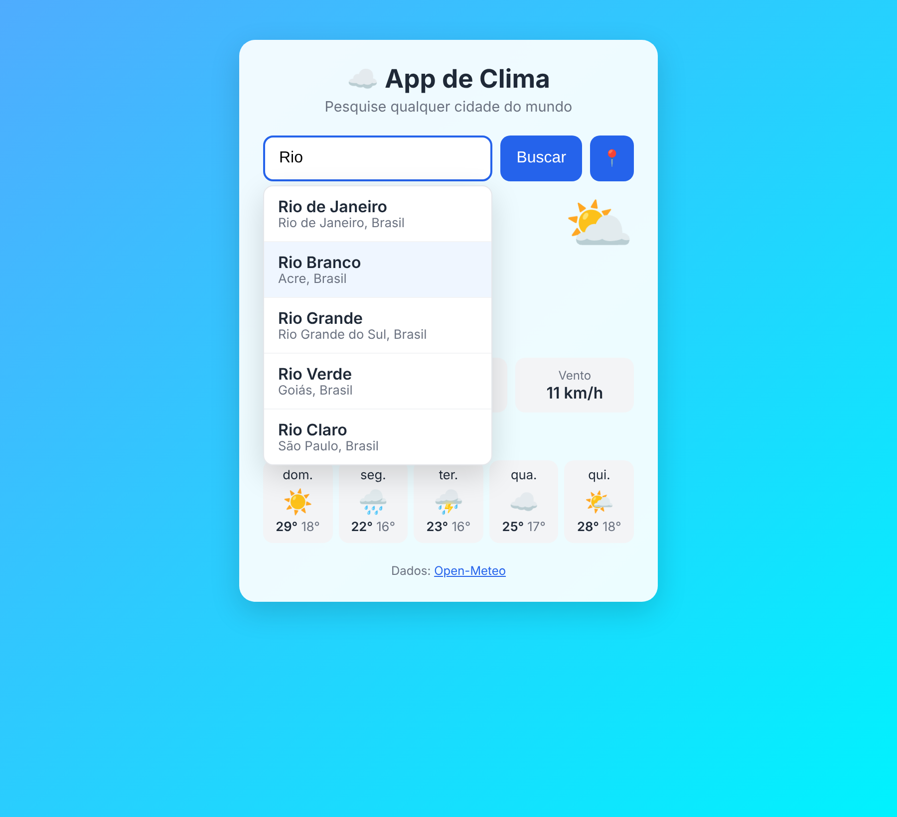

# ☁️ App de Clima

Aplicação web que mostra o **clima atual** e a **previsão para os próximos 5 dias** de qualquer cidade do mundo. Feita com **HTML, CSS e JavaScript puro** (sem frameworks), consumindo a API pública [Open-Meteo](https://open-meteo.com/).

🔗 **Acesse online:** https://moacirnascimento439.github.io/app-clima/



<p align="center">
  
  &nbsp;
  
</p>

<p align="center">
  
</p>

## ✨ Funcionalidades

- 🔎 Busca de clima por nome da cidade (com acentos, em qualquer idioma)
- ⚡ **Autocomplete**: sugestões de cidades enquanto você digita, com navegação pelo teclado (↑ ↓ Enter Esc)
- 📍 Clima da localização atual (Geolocation API do navegador)
- 🌡️ Temperatura, sensação térmica, umidade e velocidade do vento
- 📅 Previsão de 5 dias com máxima e mínima
- 🌙 Tema noturno automático quando é noite na cidade pesquisada
- 💾 Lembra o último lugar pesquisado (`localStorage`)
- ⚠️ Mensagens de erro claras: cidade inexistente, falha na API, sem internet
- 📱 Layout responsivo (celular e desktop)
- ♿ Acessibilidade: `label` no campo, padrão ARIA *combobox* no autocomplete, `aria-live` nas mensagens, foco visível

## 🛠️ Tecnologias

| Tecnologia | Uso |
|---|---|
| HTML5 semântico | Estrutura (`main`, `header`, `section`, `form`) |
| CSS3 | Variáveis, Flexbox, Grid, media queries, animação |
| JavaScript (ES6+) | `fetch`, `async/await`, manipulação do DOM, eventos |
| Open-Meteo API | Dados de geocodificação e previsão do tempo (gratuita, sem chave) |
| Playwright + `node:test` | Testes automatizados de ponta a ponta (E2E) |
| GitHub Actions | Roda os testes automaticamente a cada push |

## 🚀 Como rodar localmente

Não é necessário instalar nada para **usar** o app: basta abrir o `index.html` no navegador.

Para rodar com um servidor local (recomendado):

```bash
git clone https://github.com/moacirnascimento439/app-clima.git
cd app-clima
npx serve .
```

Depois acesse `http://localhost:3000`.

## 🧪 Testes

O projeto tem **18 testes automatizados** que abrem o app num navegador real e simulam o uso. As respostas da API são simuladas (*mocks*), então os testes funcionam sem internet e sempre dão o mesmo resultado.

```bash
npm install
npx playwright install chromium
npm test
```

O que é testado: carregamento inicial, busca, previsão de 5 dias, cidade inexistente, campo vazio, erro 500 da API, falta de internet, memória do último lugar, tema noturno, geolocalização, ausência de rolagem horizontal no celular e o autocomplete (sugestões, mínimo de 2 letras, debounce, clique, teclado e Esc).

## 📁 Estrutura

```
app-clima/
├── index.html            # Estrutura da página
├── css/style.css         # Estilos
├── js/
│   ├── weatherCodes.js   # Tradução dos códigos de clima em texto/ícone
│   └── script.js         # Lógica: API, DOM e eventos
├── tests/app.test.js     # Testes E2E
├── assets/               # Favicon e screenshots
└── .github/workflows/    # CI com GitHub Actions
```

## 📚 Aprendizados

- Consumir APIs REST com `fetch` e `async/await`, encadeando duas chamadas (cidade → coordenadas → clima)
- Tratar erros de rede e de resposta (`response.ok`) com `try/catch/finally`
- Evitar *race conditions* quando o usuário faz várias buscas seguidas
- Autocomplete com *debounce* e `AbortController` para não sobrecarregar a API
- Usar `textContent` em vez de `innerHTML` para evitar injeção de HTML (XSS)
- Escrever testes E2E com mocks de rede

## 🔮 Próximos passos

- [x] Sugestões de cidades enquanto digita (autocomplete)
- [ ] Alternar entre °C e °F
- [ ] Gráfico de temperatura por hora

## 👤 Autor

Feito por **Moacir de Jesus Nascimento** — [LinkedIn](https://www.linkedin.com/in/moacir-nascimento2003/) · [GitHub](https://github.com/moacirnascimento439)

## 📄 Licença

[MIT](LICENSE)
