# 📗 Guia de Estudo Simples — App de Clima

> Um conceito por vez: **o que é**, **a imagem do código** e **o que dizer na entrevista**.
> Os números amarelos (1, 2, 3...) nas imagens correspondem à explicação logo abaixo de cada uma.
> Os trechos foram **levemente simplificados** para destacar o conceito. O código completo está em [`js/script.js`](../../js/script.js).
>
> Quer se aprofundar? O guia completo está em [`ESTUDO.md`](../../ESTUDO.md).

## Sumário
1. [O caminho de uma busca](#1-o-caminho-de-uma-busca)
2. [HTML: o formulário](#2-html-o-formulário)
3. [CSS: variáveis e tema noturno](#3-css-variáveis-e-tema-noturno)
4. [CSS: Flexbox e Grid](#4-css-flexbox-e-grid)
5. [JS: pegando elementos da página](#5-js-pegando-elementos-da-página)
6. [JS: reagindo ao clique](#6-js-reagindo-ao-clique)
7. [JS: buscando dados com fetch](#7-js-buscando-dados-com-fetch)
8. [JS: tratando erros](#8-js-tratando-erros)
9. [JS: mostrando na tela com segurança](#9-js-mostrando-na-tela-com-segurança)
10. [JS: condição de corrida](#10-js-condição-de-corrida)
11. [JS: debounce](#11-js-debounce)
12. [JS: AbortController](#12-js-abortcontroller)
13. [JS: localStorage](#13-js-localstorage)
14. [JS: teclado](#14-js-teclado)
15. [Testes automatizados](#15-testes-automatizados)
16. [Revisão rápida antes da entrevista](#16-revisão-rápida-antes-da-entrevista)

---

## 1. O caminho de uma busca

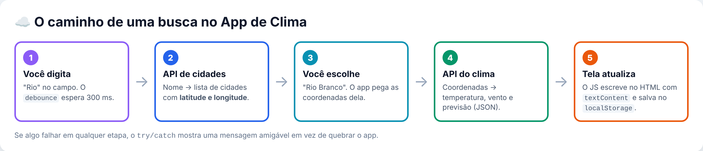

O app conversa com **duas APIs**:
- a **API de cidades** transforma o nome em **coordenadas** (latitude e longitude);
- a **API do clima** recebe as coordenadas e devolve o tempo.

São duas porque a API do clima só entende coordenadas, não nomes.

> 🧠 **Analogia:** é como pedir comida por aplicativo. Primeiro você informa o endereço (cidade → coordenadas), depois o restaurante entrega ali (coordenadas → clima).

**Os 3 arquivos principais:**
| Arquivo | Cuida de | Analogia |
|---|---|---|
| `index.html` | **O que** existe na página | O esqueleto |
| `css/style.css` | **Como** a página aparece | A roupa |
| `js/script.js` | **O que acontece** quando você interage | O cérebro |

---

## 2. HTML: o formulário

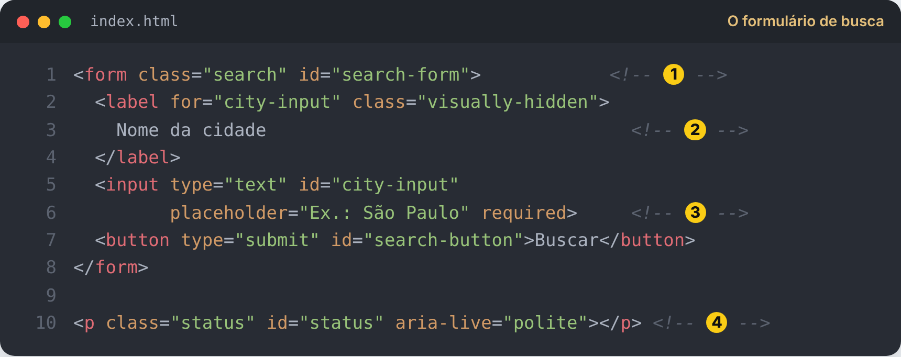

1. **`<form>`** — por usar um formulário, apertar **Enter** já faz a busca. Isso vem de graça do navegador.
2. **`<label>`** — dá nome ao campo. Fica invisível na tela, mas o **leitor de tela** (usado por pessoas cegas) lê "Nome da cidade".
3. **`required`** — o navegador não deixa enviar o campo vazio.
4. **`aria-live="polite"`** — quando aparece "Carregando..." ou um erro, o leitor de tela **anuncia** a mensagem sozinho.

> 🎤 **Na entrevista:** "Usei HTML semântico e cuidei da acessibilidade, com label no campo e aria-live nas mensagens."

---

## 3. CSS: variáveis e tema noturno

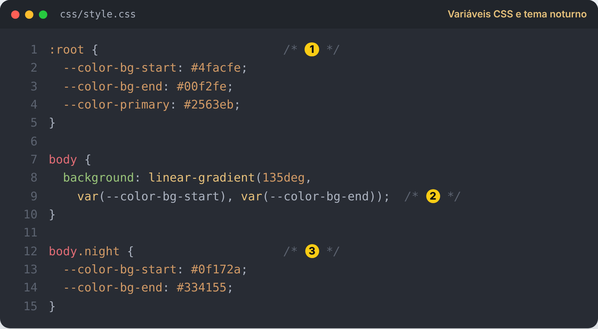

1. **Variáveis CSS** ficam no `:root` e guardam valores, como cores, para reaproveitar. Mudou num lugar, muda no site inteiro.
2. **`var(--nome)`** usa a variável. Aqui, ela monta o fundo em degradê.
3. **Tema noturno:** quando o JavaScript coloca a classe `night` no `<body>`, as variáveis ganham cores escuras e o fundo inteiro muda, sem reescrever nenhuma outra regra.

> 🎤 **Na entrevista:** "O tema noturno é só a troca de variáveis CSS. O JavaScript adiciona uma classe e o CSS faz o resto."

---

## 4. CSS: Flexbox e Grid

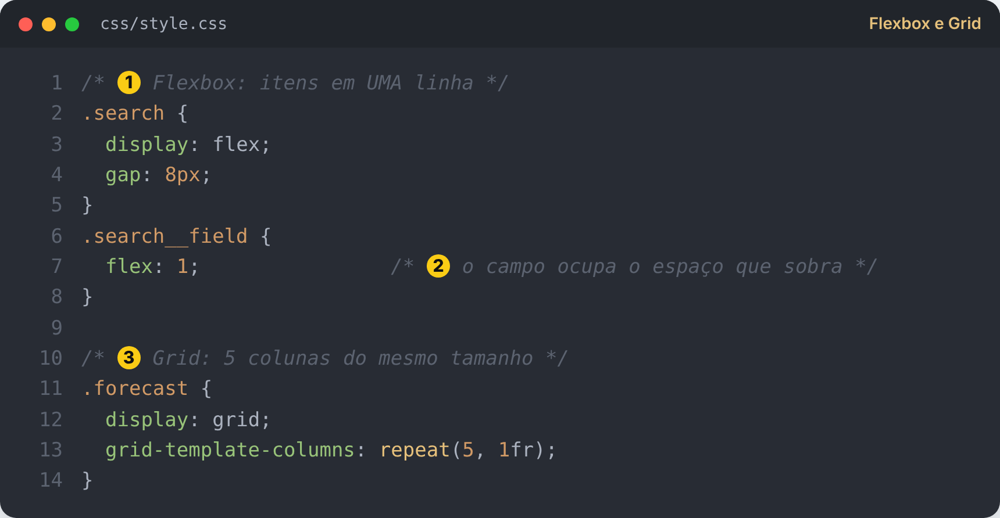

1. **Flexbox** organiza itens em **uma direção**, em linha ou em coluna. Usei na barra de busca: campo + botão + 📍.
2. **`flex: 1`** faz o campo de texto **ocupar todo o espaço que sobra**.
3. **Grid** organiza em **colunas e linhas**. `repeat(5, 1fr)` cria 5 colunas iguais, uma para cada dia da previsão.

> 🎤 **Na entrevista:** "Flexbox para uma dimensão, Grid para layouts em colunas."

---

## 5. JS: pegando elementos da página

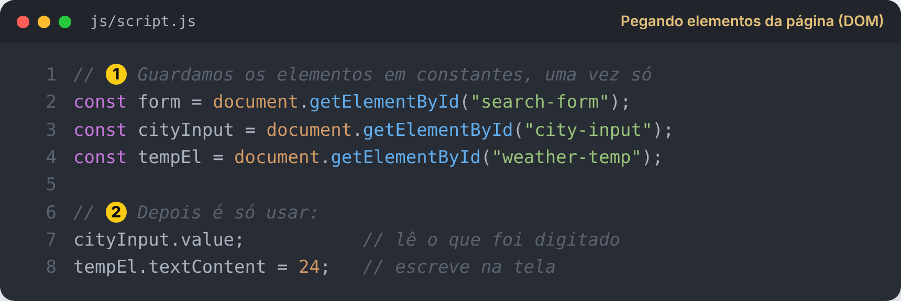

O **DOM** é a página HTML vista pelo JavaScript: uma árvore de elementos que ele pode ler e alterar.

1. `getElementById` encontra o elemento pelo `id`. Guardamos numa constante para não procurar toda vez.
2. Com o elemento em mãos: `.value` **lê** o que foi digitado e `.textContent` **escreve** texto na tela.

> 🎤 **Na entrevista:** "DOM é a representação da página em objetos, que o JavaScript consegue ler e modificar."

---

## 6. JS: reagindo ao clique

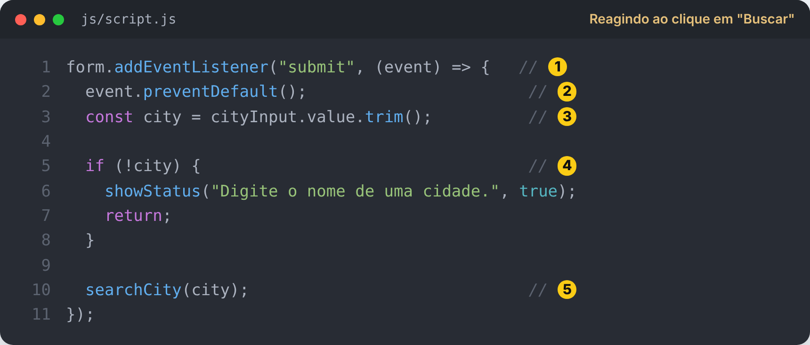

1. **`addEventListener`** significa "quando acontecer X, rode esta função". Aqui, o X é o **envio do formulário** (`submit`).
2. **`preventDefault()`** — por padrão, enviar um formulário **recarrega a página**. Isso cancela o recarregamento, para o JavaScript cuidar da busca.
3. **`.trim()`** remove espaços do começo e do fim.
4. Se ficou vazio, mostra um erro e para (`return`).
5. Senão, faz a busca.

> 🎤 **Na entrevista:** "`preventDefault` cancela o comportamento padrão do navegador; no formulário, evita o reload da página."

---

## 7. JS: buscando dados com fetch

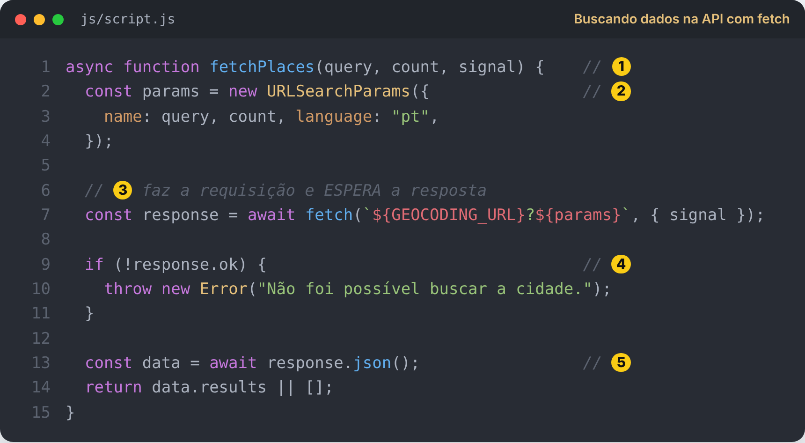

1. **`async`** marca uma função que tem passos **demorados**, como esperar a internet.
2. **`URLSearchParams`** monta a parte `?name=Rio&count=5` da URL e trata acentos e espaços sozinho.
3. **`await fetch(...)`** faz o pedido à API e **espera a resposta**, sem travar a página.
4. ⚠️ **Pegadinha famosa:** o `fetch` **não dá erro** quando a API responde 404 ou 500. Por isso conferimos `response.ok`.
5. **`.json()`** transforma a resposta (texto) em um objeto JavaScript.

> 🧠 **Analogia:** `await` é como esperar o garçom trazer o prato. Enquanto isso, o restaurante continua funcionando, ou seja, a página não congela.
>
> 🎤 **Na entrevista:** "Usei fetch com async/await e sempre verifico `response.ok`, porque o fetch só lança erro em falha de rede."

---

## 8. JS: tratando erros

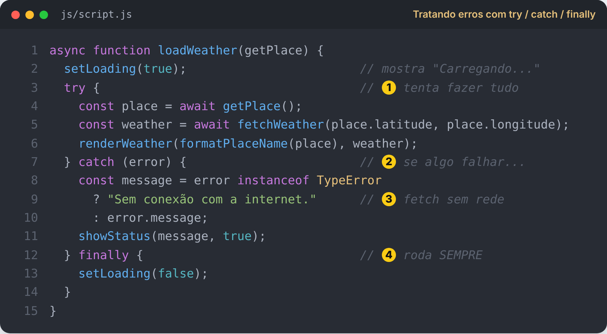

1. **`try`** — "tente fazer tudo isto".
2. **`catch`** — "se algo der errado em qualquer linha, venha para cá".
3. Se o erro for um **`TypeError`**, o fetch nem conseguiu chegar à internet, então avisamos "sem conexão".
4. **`finally`** — roda **sempre**, dando certo ou errado. Aqui ele reativa o botão "Buscar"; sem isso, o botão poderia ficar travado.

**Erros que o app trata:** cidade inexistente, campo vazio, API fora do ar, sem internet e localização negada.

> 🎤 **Na entrevista:** "O usuário nunca vê o app quebrado: todo erro vira uma mensagem amigável, e o `finally` garante que a tela volta ao normal."

---

## 9. JS: mostrando na tela com segurança

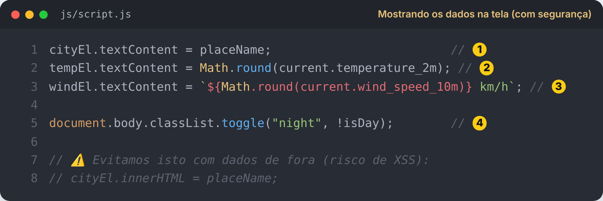

1. **`textContent`** coloca **texto puro** no elemento.
2. **`Math.round`** arredonda: 22,4 vira 22.
3. **Template literal** (crases + `${}`) junta texto e variável: `12 km/h`.
4. **`classList.toggle("night", condição)`** liga a classe se a condição for verdadeira e desliga se for falsa.

⚠️ **Por que não `innerHTML`?** Ele **interpreta HTML**. Se a API devolvesse um código malicioso no nome da cidade, ele seria executado. Esse ataque se chama **XSS**. Já o `textContent` mostra o texto como texto, sem executar nada.

> 🎤 **Na entrevista:** "Uso `textContent` com dados externos para evitar XSS."

---

## 10. JS: condição de corrida

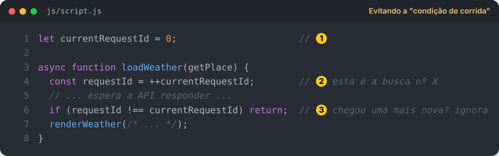

**O problema:** você busca "Manaus" (resposta lenta) e logo depois "Recife" (resposta rápida). Recife aparece... e então chega Manaus e **sobrescreve**. A tela fica errada.

**A solução** é numerar as buscas, como senhas de atendimento:
1. Um contador global.
2. Cada busca pega o próximo número.
3. Quando a resposta chega, se já existe uma busca mais nova, ela é **ignorada**.

> 🧠 **Analogia:** senha de banco. Se já chamaram a senha 8, quem tem a senha 7 e chegou atrasado não é mais atendido.
>
> 🎤 **Na entrevista:** "Tratei race conditions com um contador de requisições: respostas antigas são descartadas." ⭐ *Essa resposta mostra maturidade.*

---

## 11. JS: debounce

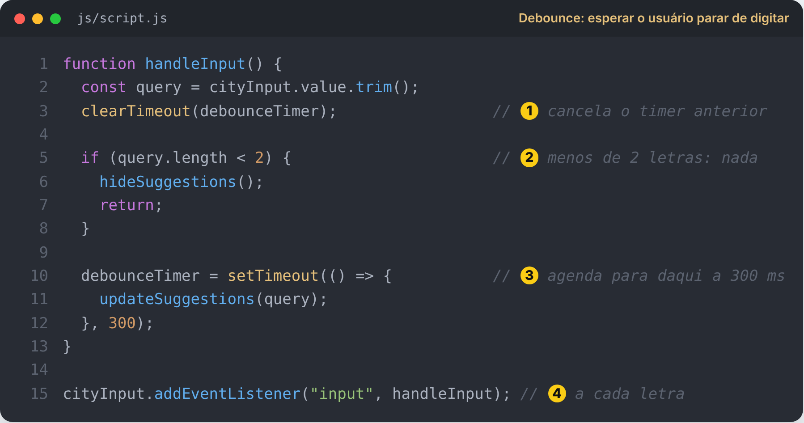

**O problema:** buscar sugestões **a cada letra** digitada. "Florianópolis" geraria **13 chamadas** à API.

**A solução — debounce:** esperar o usuário **parar de digitar** por 300 ms.
1. A cada letra, **cancela** o timer anterior.
2. Com menos de 2 letras, não busca nada.
3. **Agenda** a busca para daqui a 300 ms. Se outra letra chegar antes, volta ao passo 1.
4. Tudo isso roda no evento `input`, que dispara a cada letra.

Resultado: **1 chamada** em vez de 13.

> 🧠 **Analogia:** o elevador que espera as pessoas pararem de entrar antes de fechar a porta.
>
> 🎤 **Na entrevista:** "Debounce adia a execução até o evento parar. Throttle é diferente: executa no máximo uma vez a cada intervalo, o que é bom para scroll."

---

## 12. JS: AbortController

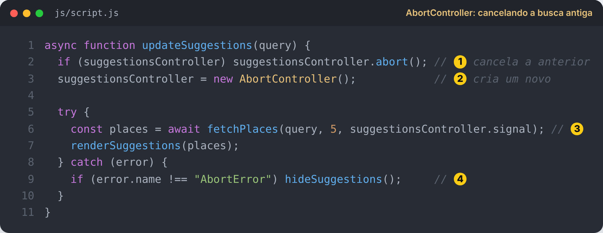

O debounce reduz as chamadas, mas uma busca antiga ainda pode chegar atrasada. O **AbortController** **cancela de verdade** a requisição anterior:
1. Se existe uma busca em andamento, **cancela** (`abort()`).
2. Cria um controlador novo para a busca atual.
3. Passa o `signal` para o `fetch`, que é o "fio" que permite cancelá-lo.
4. Uma busca cancelada gera um erro chamado `AbortError`, que **ignoramos de propósito**.

> 🎤 **Na entrevista:** "Com AbortController eu cancelo requisições que não interessam mais e economizo rede."

---

## 13. JS: localStorage

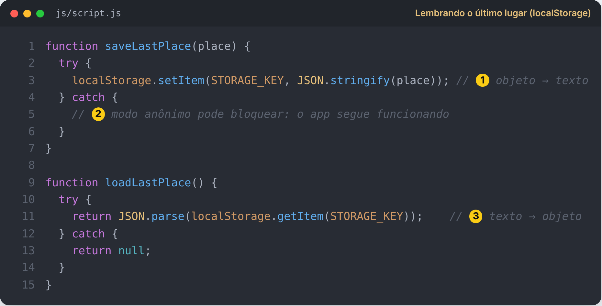

O **localStorage** é uma "gavetinha" no navegador que **continua lá** mesmo depois de fechar a aba. Usamos para lembrar o último lugar pesquisado.

1. O localStorage só guarda **texto**. `JSON.stringify` transforma o objeto em texto.
2. O `try/catch` existe porque, no modo anônimo, alguns navegadores bloqueiam o localStorage. Assim, o app continua funcionando mesmo sem salvar.
3. `JSON.parse` faz o caminho inverso: texto vira objeto.

> 🎤 **Na entrevista:** "localStorage persiste até ser apagado; sessionStorage some ao fechar a aba; cookies são enviados ao servidor em toda requisição."

---

## 14. JS: teclado

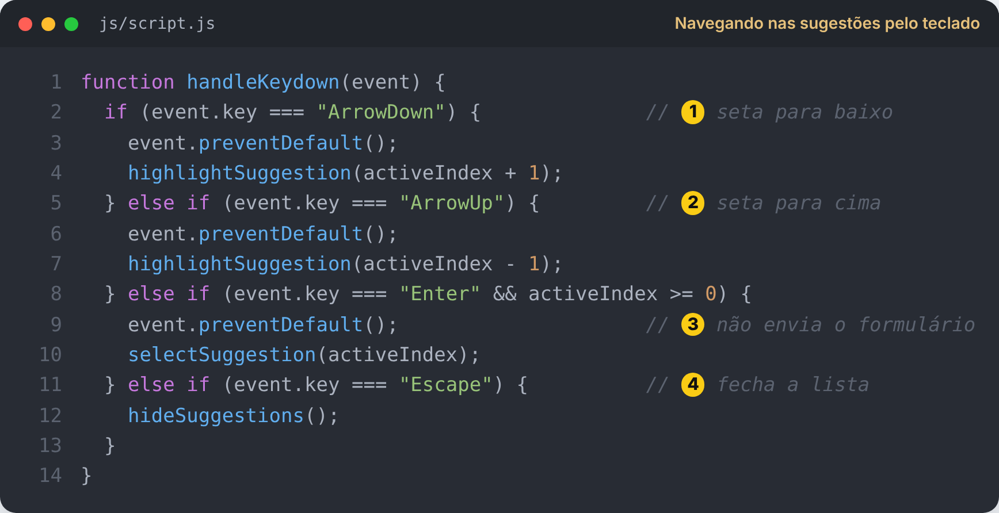

O evento `keydown` informa **qual tecla** foi apertada em `event.key`:
1. **↓** desce na lista de sugestões.
2. **↑** sobe na lista.
3. **Enter** escolhe a sugestão. O `preventDefault()` impede que o formulário seja enviado.
4. **Esc** fecha a lista.

> 🎤 **Na entrevista:** "O autocomplete funciona com mouse e teclado e segue o padrão ARIA combobox, para ser acessível."

---

## 15. Testes automatizados

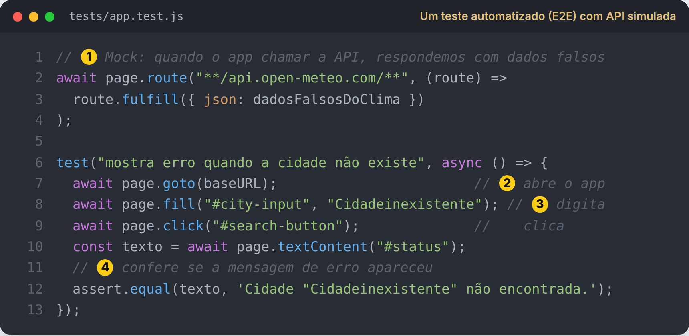

Um **teste E2E** (*end-to-end*, ponta a ponta) abre o app num **navegador de verdade** e faz o que um usuário faria.
1. **Mock** — interceptamos a chamada à API e respondemos com **dados falsos**. Assim, o teste não depende da internet e dá sempre o mesmo resultado.
2. Abre o app.
3. Digita e clica, como um usuário.
4. **Confere** se a mensagem certa apareceu. Se não apareceu, o teste falha e avisa.

O projeto tem **18 testes**, e o **GitHub Actions** roda todos sozinho a cada envio de código. Isso se chama **CI** (Integração Contínua).

> 🎤 **Na entrevista:** "Escrevi 18 testes E2E com Playwright, usando mocks da API, e eles rodam no GitHub Actions a cada push."

---

## 16. Revisão rápida antes da entrevista

### ✅ Perguntas e respostas curtas
| Pergunta | Resposta curta |
|---|---|
| O que é uma API? | Uma forma de dois sistemas conversarem. Peço dados por uma URL e recebo em JSON. |
| O que é JSON? | Um formato de texto para dados, parecido com objetos do JavaScript. |
| O que é uma Promise? | Um valor que vai chegar no futuro (pendente → resolvida ou rejeitada). |
| `async/await`? | Um jeito legível de esperar Promises, e permite usar `try/catch`. |
| `fetch` dá erro com 404? | **Não.** Só com falha de rede. Por isso confiro `response.ok`. |
| `==` × `===`? | `===` compara valor **e** tipo. Uso sempre `===`. |
| `let` × `const` × `var`? | `const` não pode ser reatribuída; `let` pode; `var` é antiga e evito. |
| `textContent` × `innerHTML`? | `innerHTML` interpreta HTML (risco de XSS). `textContent` é texto puro. |
| Debounce × throttle? | Debounce espera o evento parar; throttle limita a 1 execução por intervalo. |
| Flexbox × Grid? | Flexbox: uma direção. Grid: linhas e colunas. |
| O que é CORS? | Uma regra do navegador que bloqueia chamadas a outro site, a menos que o servidor permita. |
| Por que sem React? | Para dominar os fundamentos primeiro. O próximo projeto será em React. |

### 🎤 Apresentação em 30 segundos
> "Fiz um app de clima com HTML, CSS e JavaScript puro, consumindo a API Open-Meteo. Ele sugere cidades enquanto você digita, usando debounce e AbortController, mostra o clima atual e a previsão de 5 dias, tem geolocalização, tema noturno e trata erros como falta de internet. É responsivo, acessível e tem 18 testes automatizados com Playwright, rodando no GitHub Actions. Está publicado no GitHub Pages."

### 📝 Checklist de estudo
- [ ] Sei explicar o caminho de uma busca (seção 1) sem olhar
- [ ] Sei o que é `async/await` e por que conferir `response.ok`
- [ ] Sei explicar `try/catch/finally`
- [ ] Sei por que usar `textContent` (XSS)
- [ ] Sei explicar race condition com a analogia da senha
- [ ] Sei explicar debounce com a analogia do elevador
- [ ] Sei o que é um mock e por que usá-lo nos testes
- [ ] Treinei a apresentação de 30 segundos em voz alta
